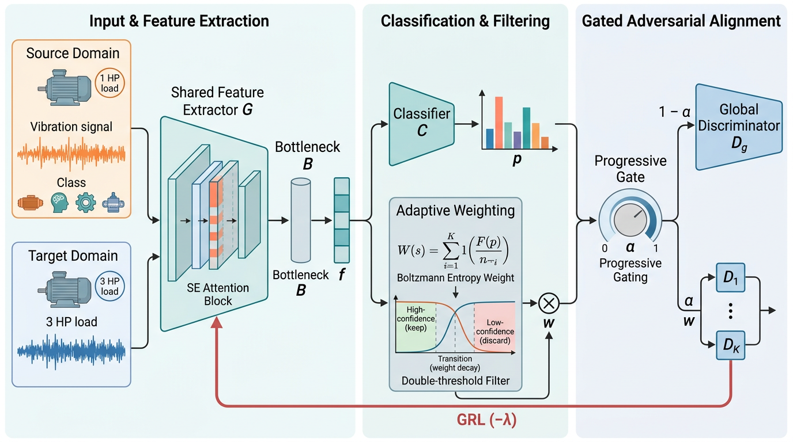

# IEFG-CDAN

> **信息熵感知细粒度条件域对抗网络**
> Information-Entropy-aware Fine-Grained Conditional Domain Adversarial Network for Cross-Working-Condition Fault Diagnosis

<p align="center">
  
</p>

本仓库为学位论文第四章方法的可复现代码，针对 **CWRU 轴承振动数据集** 上的跨工况故障诊断任务（10 类故障 × 4 个工况域）。在**源域仅保留 20% 训练样本**的工业数据稀缺场景下，IEFG-CDAN 在 12 组跨工况迁移任务上取得 **99.15%** 的平均准确率。

---

## 1. 方法简介

IEFG-CDAN 在经典 CDAN（条件域对抗网络）的基础上，针对**数据稀缺 + 伪标签噪声严重**场景做了三项核心改进：

| 编号 | 模块 | 说明 |
|------|------|------|
| ① | **Boltzmann 熵权重** | 用 `exp(-H/T)` 替代 `1+exp(-H)` 拉大高/低置信样本权重差距，T 越小区分度越大 |
| ② | **双阈值鲁棒过滤** | `max_prob < τ_low` 的极低置信样本彻底排除在细粒度对齐之外；`τ_low ~ τ_high` 之间线性过渡 |
| ③ | **渐进门控** | 训练初期仅做全局对齐（warmup），随后 `ramp_epoch` 内线性把权重 `α` 从 0 升到 1，平稳过渡到细粒度对齐 |

细粒度判别器的最终对抗输出：

```
final_ad_out = Σ_k  [ softmax_pred_k  ·  exp(-H/T)  ·  threshold_weight ]  ·  D_k(features)
```

其中源域样本始终以权重 1 参与对齐（监督可靠），仅对目标域样本做熵加权与阈值过滤。目标域上额外加一项熵最小化项 `λ_e · H(p_t)` 鼓励确定性预测。

完整实现见 [`models/AdversarialNet.py`](models/AdversarialNet.py) 中的 `FineGrainedAdversarialNet`，训练循环中的渐进门控与损失组装见 [`utils/train_utils_multiDA.py`](utils/train_utils_multiDA.py)。

---

## 2. 项目结构

```
IEFG-CDAN/
├── train_advanced.py            # 训练入口（argparse 全部超参）
├── run_chapter4_unified.py      # 第四章实验驱动：消融 + 参数敏感性 + 混淆矩阵/t-SNE
├── models/
│   ├── cnn_1d.py                # 1D-CNN 特征提取器 + SE 通道注意力
│   └── AdversarialNet.py       # AdversarialNet / AdversarialNet_multi / FineGrainedAdversarialNet
├── datasets/
│   ├── multi_CWRU.py            # CWRU 多工况域加载器（4 HP = 4 域，10 类故障）
│   ├── CWRU.py                  # CWRU 单域加载器（基线对比用）
│   ├── SequenceDatasets.py      # torch Dataset 包装
│   └── sequence_aug.py          # Normalize / Reshape / Retype / AddGaussian
├── utils/
│   ├── train_utils_multiDA.py   # 域对抗训练循环（IEFG-CDAN 主逻辑）
│   ├── train_utils_multiDG.py   # Source-Only / 域泛化基线训练循环
│   ├── logger.py
│   └── entropy_CDA.py
├── assets/IEFG-CDAN.png
├── requirements.txt
└── README.md
```

---

## 3. 环境配置

```bash
conda create -n iefg python=3.9 -y
conda activate iefg
pip install -r requirements.txt
```

测试环境：Python 3.9 / 3.10，PyTorch 1.10–2.x，单卡 GPU 即可（CPU 也能跑，但 200 epoch 较慢）。

---

## 4. 数据准备

CWRU 数据集需自行下载：

1. 官方地址：<https://engineering.case.edu/bearingdatacenter/download-data-file>
2. 按下列目录结构放到项目根目录（`.mat` 文件名需与官方一致）：

```
CWRU/
├── 12k Drive End Bearing Fault Data/   # 105.mat 106.mat ... 234.mat (9 个故障文件)
├── 12k Fan End Bearing Fault Data/
├── 48k Drive End Bearing Fault Data/
└── Normal Baseline Data/              # 97.mat 98.mat 99.mat 100.mat (4 个正常工况)
```

`datasets/multi_CWRU.py` 顶部的 `dataname` 字典列出了每个工况域 (0/1/2/3 HP) 所需的 `.mat` 文件名清单，按表下载即可。

---

## 5. 快速开始

### 5.1 单次训练（IEFG-CDAN，任务 3→0）

```bash
python train_advanced.py \
  --method DA --data_name multi_CWRU --data_dir ./CWRU \
  --transfer_task "[[3],[0]]" \
  --batch_size 32 --max_epoch 200 --source_sample_ratio 0.2 \
  --domain_adversarial True --adversarial_loss CDANN-FG \
  --warmup_epoch 5 --ramp_epoch 20 --lam_entropy 0.0 \
  --tau_high 0.8 --tau_low 0.5 --entropy_temperature 0.5 \
  --print_step 50
```

最优权重会保存到 `./checkpoint/DA/s_3_t_0/<model_name>_<timestamp>/` 下，并在 `train.log` 打印 `target_val-Acc`。

### 5.2 基线方法对比

切换 `--adversarial_loss` 与超参即可复现论文中的对比方法：

| 方法 | 关键参数 |
|------|---------|
| Source Only | `--method DG` |
| DANN | `--method DA --domain_adversarial True --adversarial_loss DA` |
| CDAN-FG（无保护） | `--adversarial_loss CDANN-FG --warmup_epoch 0 --ramp_epoch 0 --lam_entropy 0 --tau_high 1.1 --tau_low -0.1 --entropy_temperature 100` |
| IEFG-CDAN (Ours) | `--adversarial_loss CDANN-FG --warmup_epoch 5 --ramp_epoch 20 --lam_entropy 0.0 --tau_high 0.8 --tau_low 0.5 --entropy_temperature 0.5` |

### 5.3 跑完整套第四章实验（消融 / 敏感性 / 可视化）

```bash
python run_chapter4_unified.py --exp all          # 全部
python run_chapter4_unified.py --exp ablation     # 仅消融
python run_chapter4_unified.py --exp sensitivity  # 仅参数敏感性
python run_chapter4_unified.py --exp visual        # 混淆矩阵 + t-SNE
```

每组实验独立跑 3 次取均值±标准差，结果写入 `Unified_ablation_*.csv` / `Unified_sensitivity_*.csv`，可视化图写入 `unified_confusion.png` / `unified_tsne.png`。

---

## 6. 关键超参说明

| 超参 | 默认 | 含义 |
|------|------|------|
| `--source_sample_ratio` | 1.0 | 源域训练样本保留比例，论文用 0.2（20%） |
| `--max_epoch` / `--middle_epoch` | 300 / 50 | 总轮次 / 仅分类预热轮次（之后开启域对抗） |
| `--warmup_epoch` | 10 | 仅全局对齐的轮数（论文推荐 5） |
| `--ramp_epoch` | 30 | α 从 0→1 线性升温轮数（论文推荐 20） |
| `--entropy_temperature` | 1.0 | Boltzmann 温度 T，越小权重越尖锐（论文推荐 0.5/1.0） |
| `--tau_high` / `--tau_low` | 0.9 / 0.5 | 双阈值，论文推荐 0.8 / 0.5 |
| `--lam_entropy` | 0.1 | 目标熵最小化权重（论文设 0.0，细粒度对齐已足够） |
| `--num_discriminators` | 10 | 细粒度判别器数量 K，等于故障类别数 |

---

## 7. 实验结果（CWRU，20% 源样本，200 epoch，3 次均值）

### 7.1 跨工况全矩阵（12 组任务，总平均）

| Source Only | DAN | CORAL | DANN | CDAN | CDAN+E | **IEFG-CDAN** |
|:-:|:-:|:-:|:-:|:-:|:-:|:-:|
| 95.66 | 95.46 | 95.92 | 98.02 | 98.64 | 98.39 | **99.15** |

域偏移越大（Gap=3，如 3→0），IEFG-CDAN 优势越明显：Source Only 89.72% → IEFG-CDAN 98.19%。

### 7.2 消融实验（任务 [3]→[0] / [3]→[0,1,2]）

| 配置 | [3]→[0] | [3]→[0,1,2] |
|------|:---:|:---:|
| A1 DANN（全局对抗基线） | 92.59±2.43 | 93.20±3.19 |
| A2 +细粒度判别器（无保护） | 90.55±5.18 | 91.03±1.03 |
| A3 +渐进门控 | 95.53±3.89 | 97.53±0.38 |
| **A4 IEFG-CDAN（+熵加权+双阈值）** | **97.57±0.48** | **98.21±0.75** |

> A2 → A3 验证"渐进门控是稳定细粒度对齐的关键"；A3 → A4 验证"熵加权 + 双阈值过滤进一步压低方差并提精度"。

---

## 8. 引用

如本代码对您的工作有帮助，请引用相关论文/学位论文。

## 9. 致谢

- CWRU Bearing Data Center 提供公开轴承数据集
- CDAN: *Long M et al. Conditional Adversarial Domain Adaptation, NeurIPS 2018*
- DANN: *Ganin Y et al. Domain-Adversarial Training of Neural Networks, JMLR 2016*

## License

MIT License © 源仓库作者 (Zhibin Zhao et al.) 及本项目改进者。
